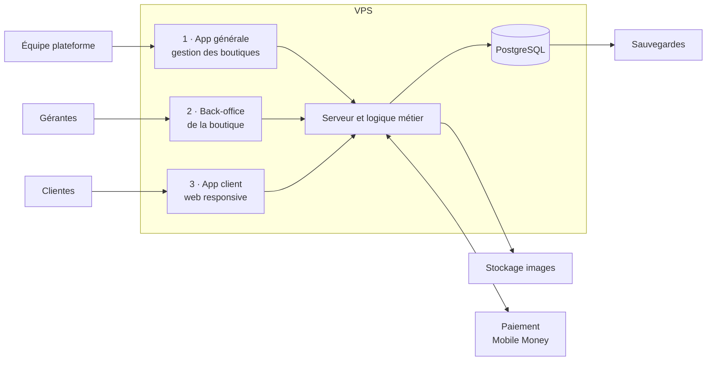

# Stack technique

> **Statut : proposition révisée.** Décidé : PostgreSQL autohébergé, Nuxt. Les points « à vérifier » doivent être confirmés avant de s'engager.

## Contraintes qui guident le choix
- Multi-boutiques avec isolation stricte (voir [plateforme.md](../produit/plateforme.md))
- Paiement UEMOA : Mobile Money et cartes, un compte marchand par boutique
- Un seul mainteneur, profil senior : l'autohébergement est assumé
- Design libre, inspiré de Vlisco ; 3D en phase 2
- Mobile d'abord, connexions moyennes
- Code généré avec l'IA : stack mainstream, bien documentée et typée

## Architecture

| Couche | Choix | Rôle |
|---|---|---|
| Application | **Nuxt (Vue)** + TypeScript, voir « Framework » | Vitrine des boutiques et back-office dans une seule application |
| Style | **Tailwind CSS** | Design sur mesure, thèmes pilotés par les paramètres de la boutique |
| API (backend) | **⏳ Langage en suspens** (TypeScript + Hono, Go ou Python à trancher après la validation des écrans), application distincte du monorepo | Logique métier unique : stock, paiement, isolation. Types et schémas Zod partagés avec les frontends, client typé de bout en bout, OpenAPI possible pour un futur mobile |
| Bibliothèque UI | **Nuxt UI** (back-office) + composants maison sur **Reka UI** (vitrine), voir « Bibliothèque UI » | Composants accessibles, thémables par variables CSS |
| Base de données | **PostgreSQL autohébergé** | Données métier, sans fonction propriétaire |
| Accès aux données | **Drizzle ORM** (ou Kysely) + migrations SQL versionnées | Typage et requêtes sûres |
| Isolation boutiques | **Row Level Security (RLS)** | Imposée par la base, voir ci-dessous |
| Authentification | **Better Auth** (ou équivalent) | Sessions, rôles, auto-hébergée |
| Stockage des images | **Stockage compatible S3** (MinIO sur le VPS en v1), images optimisées par l'application | Motifs détaillés, servis en WebP et tailles adaptées |
| Validation | **Zod** | Toutes les entrées validées aux frontières |
| Paiement | **Agrégateur UEMOA** derrière une interface maison | Mobile Money + cartes ; remplaçable |
| Éditeur de politiques | **Tiptap** + export PDF | Rédaction dans l'app, publication, export |
| 3D (phase 2) | **three.js** (react-three-fiber ou TresJS selon le framework), chargé à la demande | Visualiseur par texture, repli sur photos |
| Emails | **Resend** (ou équivalent) | Confirmations de commande |
| Qualité | **Vitest**, **Playwright**, **Sentry** | Tests unitaires, parcours critiques, erreurs |

## Vue d'ensemble

Trois frontends distincts partagent le même socle (authentification, validation, accès aux données, jetons de design) et la même base PostgreSQL. **Décidé : API centrale** (la logique métier vit dans un seul serveur), pour que trois frontends partagent les mêmes règles (stock, paiement, isolation) et qu'une future app mobile puisse réutiliser l'API (voir « Mobile : plus tard »). **Décidé : monorepo** avec trois applications Nuxt (app générale, back-office boutique, app client), une API Hono, et des paquets partagés (types et schémas, accès aux données, jetons de design, composants).

```
src/
  client/                  app client : la vitrine (SSR, responsive)
  client-admin/            back-office de la boutique (SPA)
  client-platform/         app générale, gestion des boutiques (SPA)
  backend/                 API (langage en suspens)
  packages/                code partagé entre applications
    design/                jetons de design
    shared/                types et règles communes
    mocks/                 données et simulation d'API (temporaire)
    ui/                    composants communs (plus tard)
infra/                     déploiement (Coolify, Docker), à venir
docs/                      spécifications et décisions
```


## Mobile : plus tard

### Décision
On se concentre sur le **web grand public, très responsive** (mobile d'abord). Les applications Android et iOS viennent après, si la demande le justifie.

### Ce qu'on fait dès maintenant pour ne pas se fermer la porte
- **Conception mobile d'abord** : l'essentiel des clientes seront sur smartphone.
- **PWA** (installable depuis le navigateur, icône sur l'écran d'accueil) : peu coûteuse, à ajouter quand le site est stable.
- **API centrale** : les trois frontends passent par la même API. Si une app mobile arrive, elle réutilise cette API telle quelle.
- **Authentification** compatible avec des jetons en plus des cookies, pour ne pas la refaire plus tard.

### Options à examiner le moment venu
Capacitor (emballer le code Vue), puis Expo ou Flutter si un rendu vraiment natif devient nécessaire. À trancher avec les données de ventes et d'usage en main. À garder en tête : Apple refuse les applications qui ne sont que des sites emballés.
## Framework : Nuxt ou Next.js
La performance est équivalente : elle dépend surtout du poids des images, du JavaScript livré et du cache.

| Critère | Next.js | Nuxt |
|---|---|---|
| Code généré par l'IA | Très bon | Bon |
| 3D | react-three-fiber, mature | TresJS, plus jeune |
| Hébergement | Optimisé Vercel, serveur Node possible | Agnostique, serveur Node natif (Nitro) |
| Multi-boutiques par sous-domaine | Middleware | Middleware serveur |

Avec l'autohébergement, l'avantage de Next.js sur Vercel disparaît, et Nuxt est à l'aise sur un serveur Node. **Le choix revient à la maîtrise de Vue ou de React.**
- [x] Framework retenu : **Nuxt** (recommandé : serveur Node autonome via Nitro, adapté à l'autohébergement, modèle plus simple que les Server Components ; la 3D utilisera three.js directement)

## Bibliothèque UI

Deux surfaces aux besoins opposés :
- **Vitrine** : identité forte, éditoriale, inspirée de Vlisco. Une bibliothèque standard donnerait un site générique.
- **Back-office** : formulaires, tableaux, modales, efficacité plutôt qu'originalité.

| Option | Pour | Contre |
|---|---|---|
| **Nuxt UI** | Module Nuxt natif, basé sur Tailwind et Reka UI, riche (tableaux, formulaires, modales, notifications), accessible, thémable par variables CSS | Look reconnaissable si non personnalisé |
| **shadcn-vue** | Le code des composants est copié dans le projet : contrôle total, très bien compris par l'IA | Vous maintenez ce code, moins de composants prêts à l'emploi |
| **PrimeVue** | Très complet (tableaux de données avancés) | Plus lourd, personnalisation Tailwind moins naturelle |
| Vuetify | Complet | Material Design : à écarter pour une vitrine premium |

### Choix proposé
- **Back-office : Nuxt UI.** Gain de temps maximal, accessibilité incluse.
- **Vitrine : composants maison sur Tailwind**, avec les primitives sans style de **Reka UI** (la base de Nuxt UI) pour ce qui demande de l'accessibilité (menus, dialogues, sélecteurs, onglets). Le design reste entièrement le nôtre.
- **Jetons de design partagés** (couleurs, typographies, rayons, espacements) en variables CSS. Ils servent de base au thème de chaque boutique (logo, couleurs) et gardent les deux surfaces cohérentes.
- **Repli** : si vous préférez tout maîtriser, shadcn-vue pour les deux surfaces.

### Règles
- Aucune couleur ou police codée en dur : tout passe par les jetons.
- Accessibilité par défaut (contrastes, clavier, libellés).
- Composants de la vitrine légers : peu de JavaScript client, car mobile d'abord.
- À vérifier : version courante de Nuxt UI et compatibilité avec la version de Tailwind retenue.

## Infrastructure autohébergée

| Élément | Choix |
|---|---|
| Serveur | **VPS** (une machine pour commencer) |
| Déploiement | **Coolify** (ou Docker Compose) : déploiement, certificats, variables d'environnement |
| Reverse proxy | Fourni par Coolify (Traefik ou Caddy) |
| HTTPS et sous-domaines | Reverse proxy de Coolify (Traefik/Caddy) avec certificats Let's Encrypt. **Pas de Cloudflare en v1.** Les sous-domaines génériques demandent un certificat wildcard (validation DNS) ou un certificat à la demande. |
| Cache des images | Cache HTTP côté serveur et en-têtes de cache longs ; CDN envisageable plus tard |
| Protection | Limitation de débit au niveau du proxy et de l'application, pare-feu du VPS |
| Base | PostgreSQL en conteneur ou installé sur l'hôte, **non exposé publiquement** |
| Sauvegardes | **pgBackRest ou WAL-G** : sauvegardes complètes + archivage continu (restauration à un instant précis), envoyées **hors du serveur** (stockage S3 chez un autre fournisseur ou un autre site) |
| Surveillance | Uptime Kuma (disponibilité), Sentry (erreurs), alertes disque et sauvegardes |

### Exigences d'exploitation
- **Restauration testée** au moins une fois avant le lancement, puis régulièrement (une sauvegarde non testée n'existe pas)
- Accès SSH par clés uniquement, pare-feu, fail2ban, mises à jour de sécurité automatiques
- PostgreSQL accessible uniquement depuis l'application, jamais depuis Internet
- Rôle applicatif **non superutilisateur** (sinon RLS est contournée)
- Plan de reprise écrit : en cas de panne du serveur, comment remonter, en combien de temps
- Mises à jour de version PostgreSQL planifiées

## Multi-boutiques : comment
- **Une seule base partagée**, chaque table métier porte un `shop_id`.
- **RLS** sur toutes les tables. À chaque requête, l'application fixe la boutique courante dans la transaction (`SET LOCAL` d'une variable de session) et les politiques RLS filtrent dessus. Le rôle de connexion n'est ni propriétaire des tables ni superutilisateur.
- **Résolution de la boutique** par sous-domaine ou chemin via le middleware. Domaines personnalisés en phase 3.
- **Paramétrage à deux niveaux** (global puis boutique) stocké en base, appliqué côté serveur.
- **Tests d'isolation** automatisés : la boutique A ne lit ni n'écrit rien de la boutique B.

## Points techniques sensibles
- **Argent** : montants en entiers (le franc CFA n'a pas de centimes), jamais en flottants.
- **Mesure** : longueurs en décimal exact.
- **Stock** : réservation et décrément dans une **transaction** (fonction SQL, verrouillage de ligne), pour exclure la double vente. Libération automatique d'une réservation si le paiement n'aboutit pas.
- **Paiement** : validation uniquement par le **webhook du prestataire, signature vérifiée côté serveur**, jamais sur le retour du navigateur. Clés des marchands **chiffrées** en base, jamais exposées au client.
- **Secrets** : variables d'environnement, jamais dans le code.
- **Limitation de débit** sur la connexion, le paiement et les endpoints publics.

## Coûts réalistes de départ

| Poste | Estimation |
|---|---|
| VPS | ~10 à 20 $/mois |
| Stockage objet externe pour les sauvegardes | ~1 à 5 $/mois |
| Nom de domaine | ~15 $/an |
| Email, monitoring | gratuit au départ |
| **Total** | **~15 à 25 $/mois** |

À comparer à ~45 $/mois avec Vercel et Supabase managés. L'économie se paie en temps d'exploitation. Tarifs à vérifier.

## Alternatives écartées
- **Next.js + Vercel + Supabase** : moins de maintenance, mais plus cher et dépendance à des services tiers. Reste la solution de repli si l'exploitation devient pesante : la base étant du PostgreSQL standard, la migration est simple.
- **Laravel + Filament** : back-office rapide, mais vitrine moins libre, 3D moins naturelle, isolation assurée seulement par le code.
- **Shopify, WooCommerce** : paiement UEMOA, liberté de design et vision multi-boutiques non couverts proprement.

## Risques et réponses

| Risque | Réponse |
|---|---|
| Perte ou corruption de la base | Sauvegardes hors serveur + archivage continu + restauration testée |
| Serveur unique en panne | Plan de reprise écrit ; haute disponibilité envisagée en phase 3 |
| Règle RLS erronée exposant des données | Tests d'isolation automatisés, rôle non superutilisateur, revue de sécurité avant mise en ligne |
| Faille système ou base exposée | Pare-feu, base privée, mises à jour automatiques, accès par clés |
| Un seul mainteneur | Infrastructure décrite en code (Compose/Coolify), documentation, alertes |
| Agrégateur de paiement inadapté | Interface de paiement abstraite, prestataire remplaçable |

## Paiement : état de la recherche
Aucune documentation officielle trouvée confirmant un modèle « un compte marchand par boutique » ou un split natif chez CinetPay ou PayDunya. Les sources sont surtout des blogs d'agences, donc non fiables pour les chiffres. Indications à confirmer : frais d'agrégateur d'environ 2 à 3,5 %, versement à J+1 à J+3, intégrations directes Wave et Orange Money moins chères (~1 à 2 %).
**Impact par phase** : le MVP (une seule boutique) n'a besoin que d'un compte marchand. La question du compte par boutique ne bloque que la phase 3.

## À vérifier avant de s'engager
- [ ] Quel agrégateur (CinetPay, PayDunya, autre) permet **un compte marchand par boutique**, et à quels frais
- [ ] Disponibilité et frais de Wave, Orange Money, MTN, Moov selon le prestataire
- [ ] Fournisseur du VPS et emplacement (latence depuis Abidjan, conformité sur la localisation des données)
- [ ] Sous-domaines génériques (`*.domaine`) via Coolify sans Cloudflare : certificat wildcard (fournisseur DNS avec API) ou certificat à la demande
- [ ] Tarifs actuels du VPS et du stockage objet

## Décisions
- [x] PostgreSQL autohébergé
- [x] Framework : Nuxt
- [ ] Backend : **en suspens** (TypeScript + Hono, Go ou Python). Décision après validation des écrans sur mocks, voir [frontend-mocks.md](frontend-mocks.md).
- [x] Structure : monorepo (pnpm workspaces)
- [ ] Fournisseur du VPS
